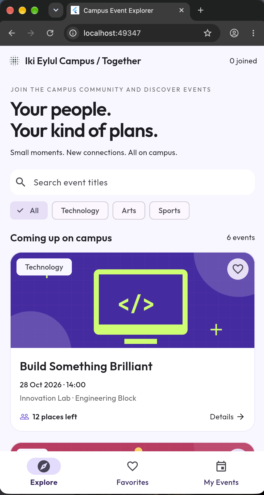
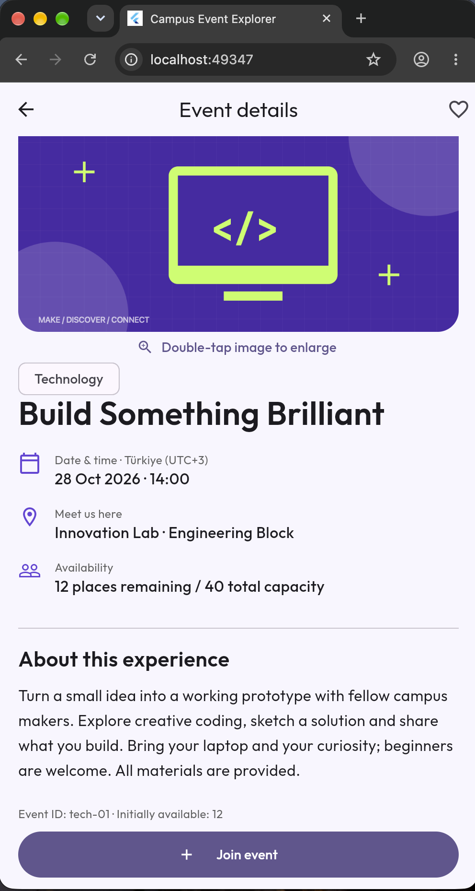
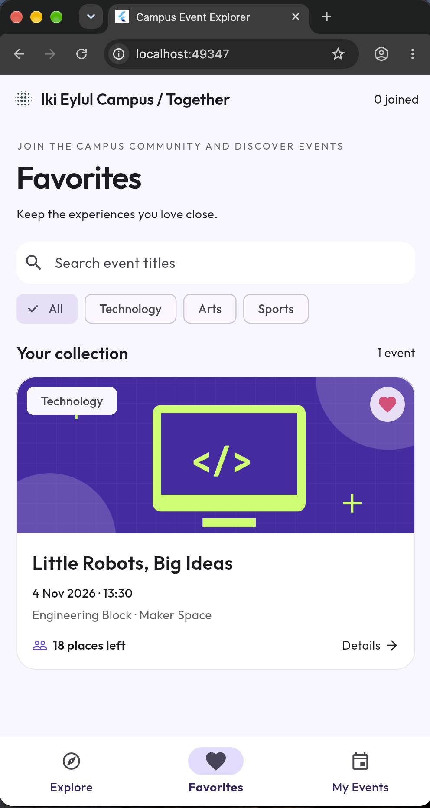
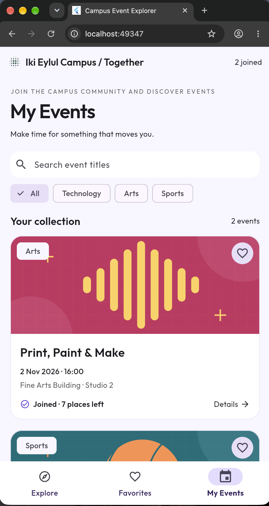

# Campus Event Explorer

Offline Flutter application for BIM493 – Mobile Programming I, Assignment #1.
Discover six fictional campus events, save favorites and manage participation.


## Team (Individual)

| Full name | Student ID | Individual contribution |
| Van Thuong Nguyen | 99843952874 | 

**My Contributions to the Project:**
- Set up and configured the Flutter project using Visual Studio Code.
- Define the code with MVC Principle (with model, view,controller), for easier debugging and testing later.
- Debugged and fixed coding errors to improve application functionality and stability.
- Implemented animation effects for tab navigation to create smoother transitions and improve the user experience.
- Tested and refined the application to ensure smooth navigation and proper functionality.
- Editting the content of the events.

## Setup and run

```sh
flutter --version
flutter pub get
flutter run
```

Optional FVM workflow (if FVM is already installed):

```sh
fvm install
fvm flutter pub get
fvm flutter run
```

For a browser preview: `flutter run -d chrome`.
For Android: start an emulator or attach a device, then `flutter run`.
For iOS: use macOS/Xcode and select your own signing team for a physical device.

## MVC structure

```text
lib/
  models/event.dart                 Event fields and date formatting
  data/events.dart                  Six fictional events and local asset paths
  controllers/event_controller.dart Session state, filters, favorites, join/cancel
  views/home_screen.dart            Explore, Favorites, My Events and search
  views/details_screen.dart         Details, confirmations and image viewer
  views/widgets/event_card.dart     Reusable StatelessWidget
  main.dart                         MaterialApp, custom font and theme
```

The controller is plain Dart. The stateful home/details views invoke its operations
inside `setState`, sharing the same controller instance across routes. No state
management package is used. Available places are derived from initial availability
and the joined-ID set. Duplicate join/cancel requests are harmless. Favorites are
independent. Search/category settings are shared between all three tabs.

## Behavior

- Six events in Technology, Arts and Sports, dated after the deadline.
- Initially full: **Sunrise on the Court**. Last place: **After Hours: Campus Sessions**.
- Title search ignores case and surrounding spaces; combines with category and tab.
- Each tab shows the matching count; app bar shows the total joined count.
- Join and cancel require Yes/No confirmation. Dismissal changes nothing.
- A joined last-place event can still be canceled and restores exactly one place.
- Details display every field. Double-tap the image to open a separate zoomable
  viewer; a labeled enlarge control offers the same action. Normal Back works.
- Favorites, participation and search persist only during the current app session.
- All displayed event times are local Türkiye campus time (UTC+3).

## UI preview and evidence

| Explore | Details |
| --- | --- |
|  |  |

| Favorites | My Events |
| --- | --- |
|  |  |


```sh
flutter test test/preview_test.dart --update-goldens
```

```sh
flutter analyze
flutter test test/widget_test.dart
flutter test test/preview_test.dart
flutter build web --release --no-web-resources-cdn
```

Testing checks in `test/widget_test.dart`:

- [x] Unique IDs, date/category requirements and capacity bounds.
- [x] Full events reject joining without changing capacity.
- [x] Last-place join, duplicate join, cancel and repeated cancel preserve capacity.
- [x] Favorites do not join events or change availability.
- [x] Combined trimmed/case-insensitive search and category filter across all tabs.
- [x] Join No and outside dismissal leave participation unchanged.
- [x] Join Yes updates controls; cancel No keeps participation; cancel Yes restores it.
- [x] Favorite changes appear after returning to the list.
- [x] Image viewer opens and supports Back.
- [x] Empty search shows a readable message and clear-filters action.
- [x] Search query survives switching tabs; My Events has a useful empty state.


## Assets and credits

- Three bundled PNG illustrations in `assets/images/`: original geometric artwork
  created with Codex assistance using `tools/create_assets.swift` (macOS AppKit).
  Permission to reuse/modify/distribute is included in `assets/images/LICENSE.txt`.
- **Outfit**, copyright 2021 The Outfit Project Authors, from
  https://github.com/google/fonts/tree/main/ofl/outfit. Bundled variable font,
  applied throughout the app. SIL Open Font License 1.1: `assets/fonts/OFL.txt`.
- Material icons: supplied by the Flutter SDK; Apache 2.0 license included
  in `assets/fonts/MATERIAL-ICONS-LICENSE.txt`.
- Cupertino icons: copyright 2016 Vladimir Kharlampidi and package contributors, MIT license,
  bundled dependency; license copied to `assets/fonts/CUPERTINO-LICENSE.txt`.

## Known limitations and submission

- Session state resets on restart, as allowed by the assignment. 
- Events and bookings are fictional. 
- No APK or signed iOS build is included. - Device/emulator testing is still recommended in addition to widget tests. SDK verification evidence is recorded below. 
- The app still doesnt the notification system for remind users about the event time. 

## Actual validation SDK output

The four previews were generated with this version:

```text
Flutter 3.47.6 • channel stable • https://github.com/flutter/flutter.git
Framework • revision 5fc346839b (3 weeks ago) • 2026-09-30 15:02:49 -0700
Engine • hash b8c8d3d8d5d0095127057f8a29ca8cc53da2167c (revision 692136cb65) (21 days ago) • 2026-09-30 00:56:59.000Z
Tools • Dart 3.13.5 • DevTools 2.60.0
```

The isolated validation SDK is at `/private/tmp/campus-flutter-3.47.6` on the
authoring machine. It is temporary and excluded from the submitted source. Use
FVM or your own Flutter 3.47.6 installation when running this project elsewhere.
The preinstalled Flutter 3.47.2 SDK was left unchanged.
